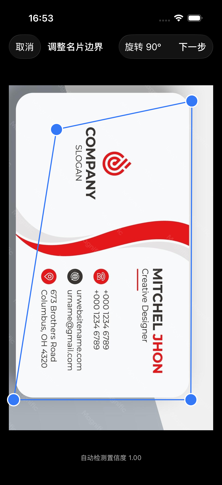
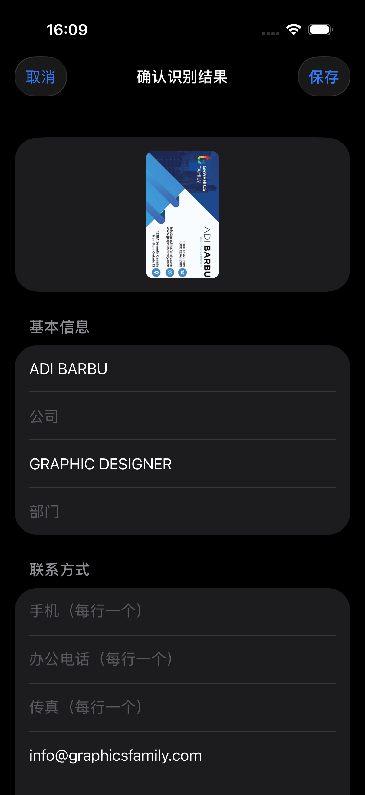
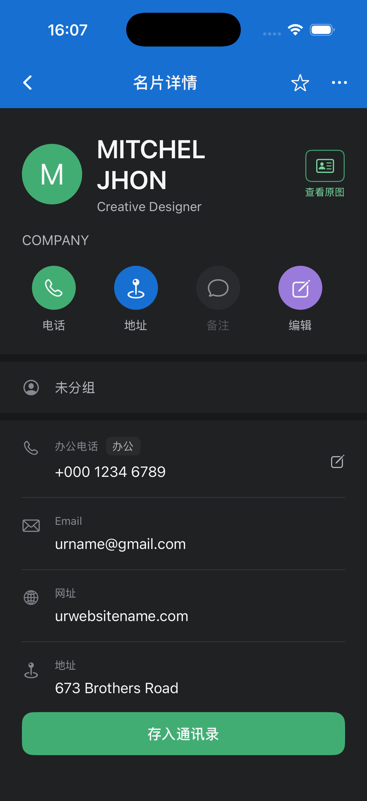
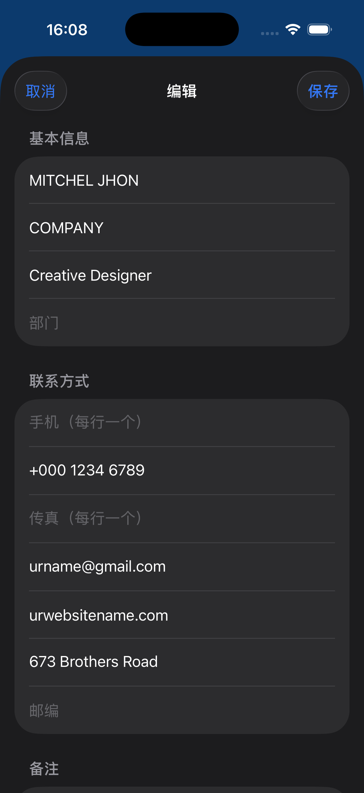
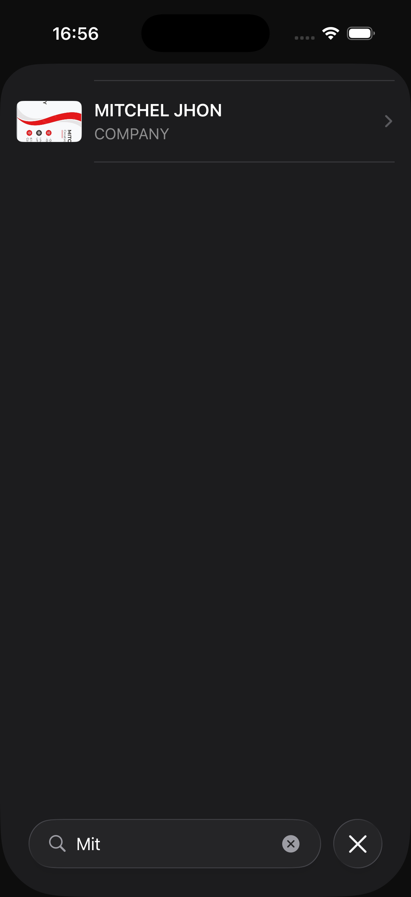

# BizScan 项目完成报告

> **基于 SDD + TRAE 的「名片全能王（CamCard）功能切片」黑盒复刻**
>
> 姓名 / 学号：待填写　｜　课程：移动应用开发　｜　日期：2026-11-06

---

## 摘要

本项目以 Specification-Driven Development（SDD）为主线，使用 TRAE 作为 AI 辅助开发环境，对 CamCard「名片数字化与联系人管理」这一封闭功能切片做了可验证的黑盒复刻。

**做了什么**：完成从名片夹 → 拍摄/导入 → 区域检测 → 透视与方向校正 → OCR → 八字段结构化 → 人工校正 → 保存 → 详情/编辑 → 搜索/标签/分组 → 本地持久化 → 联系人导出的完整闭环，共 10 个功能模块、22 个增量变更（`0001`–`0022`）。

**怎么验证的**：三层自动化测试共 184 项（`BizScanCore` 69 + iOS 单测 89 + UI 26），冻结基线 0 失败；确定性的 35 条场景按 A/B/C 三类逐条定性，其中 A 类（有真实执行证据）23 条全部通过。

**边界在哪**：项目全程无 iOS 真机，教师也未下发 Reference Test Suite 与 30–50 张正式测试名片。这两项属外部约束，已作为 B 类（行为已覆盖、系统集成未验证）与 C 类（基准缺失）显式登记，不计入通过率，也不假装完成。

> 本报告的验收数字与结论均取自 [`../acceptance-report.md`](../acceptance-report.md)，未在此处另行定义口径。

---

## 1. 作业要求与交付对应

### 1.1 要求条目映射

`要求/01.md` 第七章列出功能一至功能十。逐条对应关系如下：

| 要求条目              | 本项目实现                                                    | 关键 change                                      | 验证证据                                                                 |
| ----------------- | -------------------------------------------------------- | ---------------------------------------------- | -------------------------------------------------------------------- |
| 功能一：名片夹首页（7.1）    | `HomeView` + `HomeViewModel`，列表、空态、日期分组、常驻入口             | `0019-home-redesign`                           | `LaunchUITests`、`CardListUITests`（A 类）                               |
| 功能二：拍摄与图片导入（7.2）  | `ScannerView` + `CameraService` + `PhotoLibraryService`  | `0002-capture-import`                          | `CaptureUITests`（A）；真实拍摄为 B 类                                        |
| 功能三：区域检测与校正（7.3）  | `VisionCardDetector` + `CoreImageCorrector` + `CropView` | `0003-boundary-perspective`                    | `CardDetectorTests`、`ImageCorrectorTests`、`DetectionUITests`（B，真实拍摄） |
| 功能四：OCR（7.4）      | `VisionOCRService`，保留原始文本与坐标                             | `0004-ocr-pipeline`                            | `OCRServiceTests` + 两份评估基线（B）                                        |
| 功能五：字段结构化（7.5）    | `FieldParser` + `PhoneClassifier`，八字段 + 可选字段             | `0005-field-parser`                            | `FieldParserTests`、`PhoneClassifierTests`（A）                         |
| 功能六：确认与人工校正（第九章）  | `ReviewView` + `ReviewViewModel` + 待核对标记                 | `0006-verification-save`、`0021-review-flags`   | `ReviewViewModelTests`（A/B 见 §6）                                     |
| 功能七：保存与详情（第十章）    | `DetailView` + `DetailViewModel`，原图、字段、编辑、收藏             | `0020-detail-redesign`                         | `DetailUITests`（A）                                                   |
| 功能八：搜索与基本管理（第十一章） | `SearchView`、标签、分组、备注                                    | `0007-manage-search-tags`、`0017-card-grouping` | `SearchTagsUITests`、`CardListUITests`（A）                             |
| 功能九：本地持久化（第十二章）   | SwiftData + 沙盒图像路径                                       | `0011`、`0016-persistence-hardening`            | `PersistenceTests`、`PersistenceUITests`（A）                           |
| 功能十：联系人导出（第十三章）   | vCard 文件导出 + 写入系统通讯录                                     | `0008-export`、`0022-save-to-contacts`          | `VCardExporterTests`、`ContactsMapperTests`（B，系统面板/真实通讯录）             |

### 1.2 范围界定

复刻对象是 `01.md` 第三章定义的闭环：

```
名片夹 → 扫描名片 → 拍摄/导入 → 区域检测 → 透视/方向校正
→ OCR → 字段解析 → 人工校正 → 保存 → 名片夹 → 搜索/标签/详情 → 导出
```

以下功能**明确不在范围**（`01.md` 第十五章）：注册登录、会员支付、云同步、CRM、多设备同步、数字名片、二维码交换、AI 企业情报等。本项目未实现这些内容，属于按要求排除，而非遗漏。

### 1.3 双轨验收口径

| 类别    | 范围                         | 判定方式                                |
| ----- | -------------------------- | ----------------------------------- |
| 确定性功能 | UI、导航、状态、保存、编辑、删除、搜索、标签、导出 | Reference Test Scenarios 必须全部通过     |
| 概率性功能 | OCR、姓名/公司/职位/电话/邮箱/地址识别    | 固定测试集 + Ground Truth，计算字段级指标，保留中间产物 |

概率性功能不要求与参考 App 逐字符一致，但**虚构字段视为阻断缺陷**。

---

## 2. 方法论：SDD + TRAE 闭环

### 2.1 五阶段

| 阶段               | 动作             | 产物                                       |
| ---------------- | -------------- | ---------------------------------------- |
| Specify          | 观察参考行为，写能力规范   | `openspec/specs/` 下 11 份规范，T01–T20 场景    |
| Plan             | 发起增量变更         | `proposal.md` / `design.md` / `tasks.md` |
| Tasks            | 原子任务拆解         | 每 change ≤ 8 个任务                         |
| Implement & Test | 受控编码 + 自愈 + 验证 | 代码、测试、`docs/verify/<id>.md`              |
| Archive          | 合并增量规范         | 更新 `openspec/specs/`                     |

实际推进中，`0001`–`0008` 完成主体功能，`0009`–`0016` 补验证与加固，`0017`–`0022` 完成 UI 改版，共 22 个变更全部归档。

### 2.2 变更清单

| 编号     | 变更                         | 作用             |
| ------ | -------------------------- | -------------- |
| `0001` | app-skeleton               | 工程骨架、数据层、依赖注入  |
| `0002` | capture-import             | 相机与相册导入        |
| `0003` | boundary-perspective       | 边界检测与透视校正      |
| `0004` | ocr-pipeline               | OCR 管线         |
| `0005` | field-parser               | 八字段解析          |
| `0006` | verification-save          | 人工校正与落库        |
| `0007` | manage-search-tags         | 搜索、标签、备注       |
| `0008` | export                     | vCard 导出       |
| `0009` | acceptance-hardening       | 首轮验收加固         |
| `0010` | toolchain-compile-fixes    | 编译与工具链修复       |
| `0011` | l2-test-coverage           | L2 测试补齐        |
| `0012` | evidence-and-doc-alignment | 证据与文档口径统一      |
| `0013` | service-layer-coverage     | 服务层测试          |
| `0014` | ocr-eval-baseline          | 合成集评估基线        |
| `0015` | real-card-eval             | 真实名片评估基线       |
| `0016` | persistence-hardening      | 持久化加固 + T18 重启 |
| `0017` | card-grouping              | 分组能力           |
| `0018` | manual-card-create         | 手动新建名片         |
| `0019` | home-redesign              | 主页改版           |
| `0020` | detail-redesign            | 详情页改版          |
| `0021` | review-flags               | 待核对标记          |
| `0022` | save-to-contacts           | 存入系统通讯录        |

### 2.3 AI 上下文控制

按 `01.md` 第十六章的要求执行，而不是"一个 prompt 生成整个 App"：

- **一次 prompt 只授权一个 change 的文件范围**，越界改动需另开变更；
- **先接口后实现**：如 OCR 服务已稳定后再实现字段解析，禁止反向臆造数据层；
- **回归保护**：每次修改后重跑既有测试，禁止放宽断言变绿；
- **人工修正点留痕**：`docs/ai-collaboration/` 记录 AI 产出与人工调整。

---

## 3. 架构与技术选型

### 3.1 分层

```
BizScan (App)
├─ App/           BizScanApp、RootView、AppEnvironment（依赖容器）
├─ Views/         SwiftUI 视图 + DesignSystem
├─ ViewModels/    @Observable 状态与业务编排
├─ Services/      Camera / Detection / Correction / OCR / Pipeline / Export / Contacts
├─ Repositories/  BusinessCardRepository 协议 + SwiftData 实现 + ImageStore
└─ Models/        BusinessCardEntity（SwiftData 实体）

Packages/BizScanCore (纯 Swift，可跨平台测试)
└─ BusinessCard、FieldParser、PhoneClassifier、ContactNormalizer、
   SearchQuery、TagStore、VCardBuilder、UnverifiedValueDetector 等
```

关键约束：**UI 只依赖协议，不直接接触 SwiftData、Vision、AVFoundation**（`0001` design）。因此核心逻辑能在无模拟器的环境下用 `swift test` 验证。

### 3.2 技术栈

| 项       | 选择                                                               |
| ------- | ---------------------------------------------------------------- |
| UI / 架构 | SwiftUI + MVVM（`@Observable`）+ Repository                        |
| 并发      | Swift Concurrency（`@MainActor` + 后台 `Task`）                      |
| 持久化     | SwiftData；图像存沙盒相对路径                                              |
| 相机      | AVFoundation                                                     |
| 几何      | Vision 矩形检测 + Core Image 透视校正                                    |
| OCR     | Vision `VNRecognizeTextRequest`（`zh-Hans` + `en-US`，`.accurate`） |
| 导出      | vCard 文件（可自动化测试）+ 系统通讯录                                          |
| 工程生成    | XcodeGen（`project.yml`，`.xcodeproj` 不入库）                         |
| 测试      | XCTest + XCUITest                                                |

**不引入第三方依赖**：OCR 与几何全部使用系统框架，可离线、可回归、无供应链风险。

### 3.3 数据模型

`BusinessCard` 是 OCR、解析、校正、持久化与导出之间的唯一契约：

| 字段                                             | 类型                     | 说明              |
| ---------------------------------------------- | ---------------------- | --------------- |
| `originalImagePath` / `processedImagePath`     | `String?`              | 沙盒相对路径，不存二进制    |
| `name` / `company` / `jobTitle` / `department` | `String?`              | 缺失即 `nil`       |
| `mobiles` / `officePhones` / `faxes`           | `[String]`             | 多值字段，按语义分流      |
| `emails`                                       | `[String]`             | 多值              |
| `website` / `address` / `postalCode`           | `String?`              | —               |
| `tags` / `group`                               | `[String]` / `String?` | 标签多值，分组单选       |
| `isFavorite`                                   | `Bool`                 | 收藏              |
| `unverifiedValues`                             | `[String]`             | 低置信度或歧义值，供详情页标记 |
| `notes`                                        | `String?`              | 备注              |
| `createdAt` / `updatedAt`                      | `Date`                 | 列表排序依据          |

设计规则：**未识别字段保持** **`nil`** **或空数组，禁止用空字符串或推测值占位**——这是"不虚构"约束在类型层的落点。

### 3.4 依赖注入

`AppEnvironment` 持有仓库、图像存储与五个服务，通过 `.environment(_:)` 注入视图树。测试时替换为内存仓库与替身服务，保证 UI 测试的确定性初始状态。备选方案"全局单例"被否决，理由是掩盖依赖且不可测。

---

## 4. 功能实现

### 4.1 名片夹首页

**需求**（7.1）：列表、空态、扫描入口、缩略信息、点击进详情、搜索入口、增删后列表更新；底部只保留拍摄图标，上方保留搜索、分组管理与右上角新增。

**实现**：`HomeView` 按 `createdAt` 做日期分组，行内展示标题（姓名优先，回退公司）与副标题（公司 → 职位 → 首个联系方式）；空态引导扫描；底部常驻相机入口，顶部搜索、分组、新增。

**关键决策**：排序从 `updatedAt` 改为 `createdAt`（`0019`），避免编辑名片导致列表跳动——这与参考 App 的"按录入时间归档"行为一致。

**验证**：`LaunchUITests.testAppLaunchesToEmptyCardHolder`、`CardListUITests.testT24HomeGroupsByCreatedDate`、`testT25HomeKeepsPersistentEntries`（A 类）。


### 4.2 拍摄与图片导入

**需求**（7.2）：相机预览、权限申请、拍摄、返回、取消、重拍、相册导入、结果预览、确认进入识别。

**实现**：`ScannerView` + `CameraService`（AVFoundation）与 `PhotoLibraryService`（PhotosUI）。权限被拒时展示独立说明页，提供「打开设置」与「返回」。

**关键决策**：相机不可用（模拟器）时进入 `.denied` 分支而不是崩溃，使 UI 测试能在模拟器上跑通入口路径；真实拍摄相关项交由真机程序承接。

**验证**：`CaptureUITests.testT02OpenScannerAndReturn`（A）；T04/T05 为 B 类。

> 截图待补：模拟器无相机，扫描取景页需真机补拍；补入后作为「图 4-3」插入本节。

### 4.3 区域检测与透视/方向校正

**需求**（7.3）：自动检测边界、显示结果、自动裁剪、透视校正、方向校正、手动调整、确认、重拍。

**实现**：`VisionCardDetector` 用 `VNDetectRectanglesRequest` 取四点；`CoreImageCorrector` 用 `CIPerspectiveCorrection` 拉正，并支持 90° 步进旋转；`CropView` 允许手动拖点并显示置信度。

**关键决策**：检测失败时保留默认四点而不是中断流程，用户可手动调整——比"检测失败即报错"更符合真实拍摄场景。

**验证**：`CardDetectorTests`（4 项）、`ImageCorrectorTests`（3 项）、`CropViewModelTests`（5 项）、`DetectionUITests`（2 项）；真实拍摄八类条件为 B 类。



### 4.4 OCR

**需求**（7.4）：中文、英文、双语、横版、竖版、不同字体字号版式、多电话多邮箱、字段缺失、复杂背景。

**实现**：`VisionOCRService` 调用 `VNRecognizeTextRequest`，指定 `zh-Hans` + `en-US` 与 `.accurate`，输出 `OCRObservation`（文本 + 归一化坐标 + 置信度）。

**关键决策**：保留**原始文本与坐标**，不直接输出字段。这样字段解析错误可以回溯到 OCR 错字，满足"链路可分析"的要求。

**验证**：`OCRServiceTests.testT07RecognizesSyntheticCardText`；两份评估基线见 §6.4。

### 4.5 字段结构化

**需求**（7.5）：Name、Company、Job Title、Mobile、Office Phone、Email、Website、Address，可选 Department、Fax、Postal Code、Notes。

**实现**：`FieldParser` 按标签优先、版式次之的规则解析；`PhoneClassifier` 负责手机/办公/传真分流；`ContactNormalizer` 做全角半角与号码归一。

**关键决策**：无法确认的字段返回 `nil`，不做语义补全。典型反例是"名片没有 Website 却被推断出一个网址"，本项目用 `NoFabricationTests`（7 项）守住这条线。

**验证**：`FieldParserTests`（13 项）、`PhoneClassifierTests`（8 项）、`NoFabricationTests`（7 项）（A 类）。

### 4.6 确认与人工校正

**需求**（第九章）：识别结果不得直接保存，必须经过人工确认；支持修改八个字段，处理空字段、多号码、OCR 错字、取消修改。

**实现**：`ReviewView` 以可编辑表单呈现解析结果；`ReviewViewModel` 负责落库与二次确认；低置信度或歧义值写入 `unverifiedValues`，详情页以「待核对」胶囊提示。

**关键决策**：空名片允许保存但必须二次确认；仅含传真号的名片不算空卡（K1 修复）。

**验证**：`ReviewViewModelTests`、`UnverifiedValueDetectorTests`、`DetailUITests.testT29ReviewBadgeIsShown`（A）。T30 的 UI 断言未落地，见 §6.3 的 B 类说明。



### 4.7 保存与详情

**需求**（第十章）：保存原图、处理图、结构化字段、标签、备注、创建时间；详情页支持查看原图、编辑、保存、删除、返回、点击电话/邮箱/网址。

**实现**：`DetailView` 采用自定义深色顶栏，展示核心资料、联系方式、快捷操作、原图入口与「存入通讯录」；`DetailViewModel` 统一处理字段行、收藏、备注与外部链接生成。

**关键决策**：快捷操作只生成 URL 并交给系统打开，不内嵌拨号/地图/邮件实现——与"涉及外部系统调用可调用原生组件"的要求一致。

**验证**：`DetailUITests`（8 项）+ `DetailViewModelTests`（9 项）（A）；外部 App 实际调起为 B 类。





### 4.8 搜索 / 标签 / 备注

**需求**（第十一章）：按姓名、公司、职位、电话、邮箱搜索；标签创建 → 添加 → 按标签查看 → 删除；备注增删改。

**实现**：`SearchQuery` 做格式无关匹配（忽略空格与分隔符），`SearchView` 以 sheet 呈现结果；标签与分组由 `TagStore` 与仓库层维护；备注在详情页内联编辑。

**关键决策**：搜索不依赖数据库查询能力，内存过滤即可覆盖当前数据规模，换取可测试性与跨平台复用。

**验证**：`SearchTagsUITests`（3 项）、`SearchQueryTests`、`TagStoreTests`、`HomeViewModelTests`（A）。




### 4.9 本地持久化

**需求**（第十二章）：保存后 Kill App，重启仍能找到该名片，且原图、修改后字段、标签、备注都在。

**实现**：SwiftData 存储记录，图像写入沙盒并由相对路径引用；`ImageStore` 负责写入与清理。

**关键决策**：测试用**同一 URL 重建容器**模拟重启（`PersistenceTests`），再用 `XCUIApplication.terminate` + 重启做进程级验证（`PersistenceUITests`）。这比只测内存仓库更接近真实。

**验证**：`PersistenceTests`（6 项）、`PersistenceUITests.testT18DataSurvivesRelaunch`（A，模拟器）；真机 kill 未复跑。

### 4.10 联系人导出

**需求**（第十三章）：至少实现写入系统联系人 **或** 导出 VCF；验证姓名、公司、职位、电话、邮箱、地址映射。

**实现**：两条都做。`VCardFileExporter` 生成 3.0 格式 vCard（75 字节折行、转义、多值）；`ContactsMapper` 将名片映射为 `CNMutableContact`，`SystemContactsService` 负责权限与写入。

**关键决策**：优先 vCard，因为不依赖通讯录权限、可自动化测试；系统通讯录作为补充能力。

**验证**：`VCardBuilderTests`（7 项，L1）、`VCardExporterTests`（5 项，L2）、`ContactsMapperTests`（5 项）、`DetailViewModelTests` 三条状态机（B 类，真实写入待真机）。


---

## 5. AI 能力边界实测

`01.md` 第八章要求专门考察五类风险。本项目逐条落地：

| 风险                                         | 应对设计                                        | 实测结论                          |
| ------------------------------------------ | ------------------------------------------- | ----------------------------- |
| 字段歧义（如 Apple 是公司、产品还是地址）                   | 标签优先 + 版式位置；歧义时写 `ParsingDiagnostic` 并标为待核对 | 歧义值不强行归类，进入待核对                |
| 人名与公司混淆（Jordan Lee / Lee Consulting）       | 首行优先判人名，含公司后缀词（Ltd/Inc/大学/学院）优先判公司          | 有单测覆盖；真实样本仍存在误判，需人工校正         |
| 多电话号码                                      | `PhoneClassifier` 依据标签与号段分流手机/办公/传真         | 有 8 项单测覆盖                     |
| 中英文混排（朱宏明 / Professor / Tongji University） | 分词与标签双向匹配，不依赖单一语言假设                         | 有单测覆盖；真实样本准确率见评估基线            |
| 字段缺失不得虚构                                   | 未识别返回 `nil`；空串等同于缺失                         | **虚构字段计数 0**（合成 15 例、真实 14 例） |

"不虚构"是本项目最严格的一条约束，落点有三处：模型层禁止占位值、解析层返回 `nil`、测试层专项断言（`NoFabricationTests`）。

人工校正成本（平均修改字段数）**尚未产出**，这是已知缺口，不影响确定性功能判定。

---

## 6. 测试与验证

### 6.1 三层策略

| 层  | 范围                        | 执行方式                                             | 规模 |
| -- | ------------------------- | ------------------------------------------------ | -- |
| L1 | `BizScanCore` 纯逻辑         | `swift test --package-path Packages/BizScanCore` | 69 |
| L2 | iOS 单元测试（仓库、ViewModel、服务） | `bash scripts/verify.sh --scope unit`            | 89 |
| UI | T01–T35 端到端               | `bash scripts/verify.sh --scope ui`              | 26 |

统一入口 `scripts/verify.sh` 会生成 Xcode 工程、执行测试并产出 `artifacts/*.log` 与 `.xcresult`。

### 6.2 冻结基线

| 项  | 值                                                                          |
| -- | -------------------------------------------------------------------------- |
| 时间 | 2026-11-06 15:25                                                           |
| 环境 | macOS 26.3.1 + Xcode 26.1.1 + iPhone 16 模拟器 / iOS 18.0                     |
| 结果 | **184 项，0 失败**                                                             |
| 构成 | core 69 + L2 89 + UI 26                                                    |
| 证据 | [`../verify/0022-save-to-contacts.md`](../verify/0022-save-to-contacts.md) |

UI 26 项分布：`LaunchUITests` 1、`CaptureUITests` 2、`CardListUITests` 9、`DetailUITests` 8、`SearchTagsUITests` 3、`PersistenceUITests` 1、`DetectionUITests` 2。


### 6.3 场景结论

采用三分类，避免把"做不了"和"没做"混为一谈：

| 类别              | 含义                  | 数量      |
| --------------- | ------------------- | ------- |
| A 已验证           | 有真实执行证据             | 23 / 35 |
| B 行为已覆盖，系统集成未验证 | 逻辑有测试，剩余依赖真机或系统 App | 12 / 35 |
| C 环境不可达         | 基准或资产缺失             | 3 项基准缺口 |

A 类 23 条全部通过、0 失败。B 类集中在三处：相机与相册（T03–T07）、导出与通讯录（T19、T31–T33）、少数仅 L2 覆盖的交互（T11、T12、T30）。逐条明细见 [`../acceptance-report.md`](../acceptance-report.md) 第 5 节。

### 6.4 概率性功能评估

| 项       | 数据集    | 结果                         | 局限                    |
| ------- | ------ | -------------------------- | --------------------- |
| 合成集字段抽取 | 15 例自建 | 虚构字段 0                     | 样本 < 30，只报绝对值         |
| 真实名片集   | 14 张本机 | 检测 11/14、OCR 非空 12/14、虚构 0 | 样本 < 30，未与 CamCard 对比 |
| 边界检测    | 同上     | 成功率 11/14                  | 八类拍摄条件完整覆盖 3/8        |

链路始终保留 `原始名片 → OCR Raw Text → Structured Fields → Manual Correction → Final Contact`，原始输出落盘在 `docs/eval/raw/`。

### 6.5 环境约束

| 编号 | 约束               | 后果                               |
| -- | ---------------- | -------------------------------- |
| E1 | 无 iOS 真机         | 相机权限时序、真实通讯录、系统分享面板、系统 App 调起未验证 |
| E2 | 模拟器无相机与通讯录       | 采集段与写入段无法端到端自动化，改用注入图片与替身服务      |
| E3 | 教师 RTS 与正式数据集未下发 | 无法执行教师口径用例，准确率只能报自建样本绝对值         |

这三条是外部约束，不是未完成的工作项。处理方式已写入验收结论书第 4 节。

### 6.6 未验证项的可转移程序

真机项没有停留在"待办"，而是整理为一份可交接的执行程序：[`../verify/manual-device-checklist.md`](../verify/manual-device-checklist.md)。每条包含前置状态、操作步骤、判定标准与证据命名规则（如 `T03-allow-01.mov`）；结果表保持空白，因为**未执行就是未执行**。

---

## 7. 差异分析与修正

### 7.1 缺陷台账

| 编号 | 现象                                | 影响           | 处理          |
| -- | --------------------------------- | ------------ | ----------- |
| K1 | `isEmptyCard` 未统计传真号，仅含传真号的名片被判空卡 | 空名片二次确认误触发   | 已修复并补测      |
| K2 | 「已存入」状态不持久化，重进详情复位                | 重复点击防护仅限当前页面 | 设计未定义，登记待决策 |

### 7.2 变更内偏差

| 编号 | 偏差                                            | 等级 | 处理                                      |
| -- | --------------------------------------------- | -- | --------------------------------------- |
| D1 | 模拟器白屏，SpringBoard 未运行                         | 严重 | `launchctl kickstart` 恢复后重跑，两次验证均在恢复后执行 |
| D2 | IDE 终端 `xcodebuild` 报 `DTServiceHubClient` 失败 | 一般 | 统一在 Terminal.app 执行，不改工程配置              |
| D3 | `ObservationMacros` 宏插件卡死                     | 一般 | `killall -9 swift-plugin-server` 后恢复    |
| D4 | 真机项、分享面板无结果                                   | 一般 | 转为 B 类，附可转移程序                           |
| D5 | T30 与标签删除无 UI 断言                              | 一般 | 功能已完成，由 L2 覆盖；根因是多行输入框焦点不稳定             |

### 7.3 回归原则

- 每次变更后必须重跑既有测试，与 `docs/regression-log.md` 最近基线对照；
- 失败时修实现或修测试，**禁止放宽断言让结果变绿**；
- 基线只增不改，历史行保留原始结论。

---

## 8. 项目管理与过程证据

### 8.1 文档体系

| 目录 / 文件                     | 作用                                   |
| --------------------------- | ------------------------------------ |
| `openspec/specs/`           | 11 份能力规范，行为合同的唯一真实源                  |
| `openspec/changes/archive/` | 22 个已归档变更的 proposal / design / tasks |
| `docs/verify/`              | 每个变更的验证报告，含环境、命令、逐条 PASS/FAIL        |
| `docs/eval/`                | OCR 与字段准确率基线、原始输出                    |
| `docs/traceability.md`      | T01–T35 ↔ 规范 ↔ 测试                    |
| `docs/verification-debt.md` | 验证台账，A/B/C 逐条记账                      |
| `docs/acceptance-report.md` | 验收结论书，唯一对外口径                         |

### 8.2 关键决策记录

| 决策                       | 备选             | 理由                         |
| ------------------------ | -------------- | -------------------------- |
| 用 Apple Vision 做 OCR 与检测 | 第三方 OCR SDK    | 无依赖、可离线、可回归；参考项目亦采用 Vision |
| vCard 优先于系统通讯录           | 只做通讯录          | 不依赖权限、可自动化测试               |
| SwiftData 存记录 + 沙盒存图     | 图像存二进制         | 避免数据库膨胀，便于清理与替换            |
| 逻辑层独立成 SwiftPM 包         | 全部放 App target | 纯逻辑可在无 iOS 环境测试，降低验证成本     |
| UI 只依赖协议                 | 直接调用服务         | 可注入替身，UI 测试确定性             |
| 分组单选、标签多值                | 两者都为多值         | 与参考 App 的信息结构一致            |

---

## 9. 局限与后续工作

### 9.1 当前局限

1. 无真机，系统级行为（权限时序、真实通讯录、分享面板、外部 App 跳转）仅有代码级证据。
2. 教师 RTS 未下发，验收以作业原文条目为准，无法声明与教师用例逐条等价。
3. 概率性功能样本量均 < 30，只能报绝对值，不能报百分比指标。
4. 人工校正成本（平均修改字段数）尚未产出。
5. T30 与标签删除缺少 UI 断言，仅有 L2 覆盖。

### 9.2 补齐路径

| 条件              | 动作                                                                    |
| --------------- | --------------------------------------------------------------------- |
| 获得真机            | 按 `manual-device-checklist.md` 执行，回填 `manual-device-<日期>.md`，B 类转 A 类 |
| 获得教师 RTS        | 建立条目映射并补执行记录；口径冲突处另开 change                                           |
| 获得 30–50 张正式名片集 | 重跑评估，替换现有基线，样本 ≥ 30 后可报百分比                                            |

三项均不改变实现，只补充验证与映射。

---

## 10. 结论

本项目完成的不是一个"能拍照识别的演示"，而是一条可审查的工程链路：**行为先写成规范，规范再由测试证明，未证明的部分如实记账**。

具体地：

- 十项功能全部实现并形成闭环；
- 184 项自动化测试 0 失败，A 类 23 条确定性场景全部通过；
- 虚构字段计数为 0，"不虚构"这条最严格的约束有专项测试守护；
- 12 条 B 类与 3 项 C 类缺口逐条登记，附可转移的真机程序与明确的补齐路径。

因此对作业的核心问题——**"能否用规格和测试证明这些功能按要求工作"**——的回答是：**在可执行范围内可以，且未验证的部分没有被隐藏。**

---

## 附录

### A. 术语表

| 术语           | 含义                               |
| ------------ | -------------------------------- |
| Txx          | `01.md` 第十七章定义的验收场景编号，本仓库扩展到 T35 |
| A / B / C 类  | 已验证 / 行为已覆盖但系统集成未验证 / 环境不可达      |
| L1 / L2 / UI | 逻辑层 / iOS 单元层 / 界面自动化层           |
| change       | OpenSpec 的增量变更，一个可命名的行为增量        |
| 待核对          | 低置信度或歧义解析出的值，需人工确认               |

### B. 命令清单

```bash
make project    # 生成 BizScan.xcodeproj（XcodeGen）
make core       # 只跑 BizScanCore 单测
make unit       # core + iOS 单元测试
make ui         # core + UI 测试
make verify     # 全量验证
make specs      # 校验 OpenSpec 规范
```

### C. 文件索引

| 路径                                          | 内容                      |
| ------------------------------------------- | ----------------------- |
| `Packages/BizScanCore/Sources/BizScanCore/` | 模型、解析、号码分类、vCard、搜索、标签  |
| `BizScan/Views/`                            | 主页、扫描、校正、确认、详情、搜索、分组、新建 |
| `BizScan/Services/`                         | 相机、检测、校正、OCR、管线、导出、通讯录  |
| `BizScan/Repositories/`                     | 仓库协议、SwiftData 实现、图像存储  |
| `docs/acceptance-report.md`                 | 验收结论书                   |
| `docs/traceability.md`                      | 场景追踪矩阵                  |
| `docs/verification-debt.md`                 | 验证台账                    |
| `docs/eval/`                                | 准确率基线与原始输出              |

### D. 截图清单

图片统一存放在 `docs/report/screenshots/`，文件名与图号一致。

| 编号     | 内容         | 文件                        | 状态  |
| ------ | ---------- | ------------------------- | --- |
| 图 4-1  | 首次启动空名片夹   | `4-1-home-empty.png`      | 已就位 |
| 图 4-2  | 名片列表（日期分组） | `4-2-home-list.png`       | 已就位 |
| 图 4-3  | 扫描取景页      | —                         | 待补（模拟器无相机，需真机补拍） |
| 图 4-4  | 边界校正页      | `4-4-crop.png`            | 已就位 |
| 图 4-5  | 确认识别结果页    | `4-5-review.png`          | 已就位 |
| 图 4-6  | 名片详情页      | `4-6-detail.png`          | 已就位 |
| 图 4-7  | 编辑页        | `4-7-edit.png`            | 已就位 |
| 图 4-8  | 搜索页        | `4-8-search.png`          | 已就位 |
| 图 4-9  | 分组管理页      | `4-9-groups.png`          | 已就位 |
| 图 4-10 | 存入通讯录成功态   | `4-10-contacts.png`       | 已就位 |

